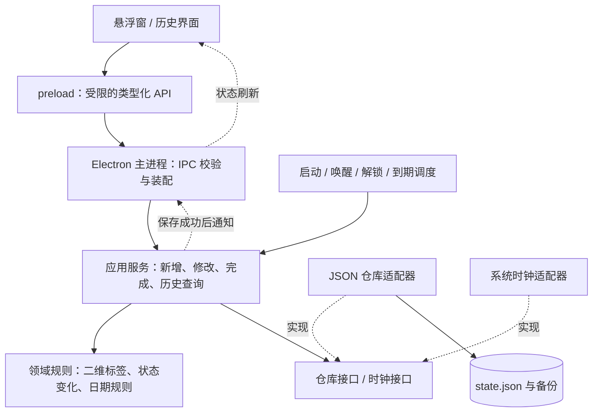

**Windows 桌面日程表：架构调研与后端方案**

调研日期：2026-10-26。本文是设计建议，尚未实现业务代码，也未进行 Windows 窗口或性能实测。技术能力依据项目官方文档；模块划分、数据规则和开发顺序是针对本项目的设计判断。

**建议采用 TypeScript + Electron，以独立的 TypeScript 业务核心为中心，使用本地 JSON 仓库，最后接入小型悬浮界面。** 这里的“后端”指运行在电脑上的事件管理、历史查询和存储逻辑。它可以由 Electron 主进程调用，无需先建立 HTTP 服务或部署服务器。

1. **需求与首版边界应先固定。**

已确认的需求：Windows 桌面边缘的小型日程表；事件有标题、重要性和紧急性两个维度、时间属性；到时间自动划线；JSON 保存数据；通过界面按天查看历史。用户已明确：自动划线表示已到期，是否完成由用户另行确认。

建议首版将“时间属性”解释为一个截止时刻 `dueAt`，将“贴在桌面”解释为可拖动、可贴边、可切换置顶的普通悬浮窗口。开始时间与结束时间、重复任务、云同步、多人共享、工时记录及真正嵌入桌面壁纸层，留作后续独立需求。

历史功能首先回答“这一天记录完成了什么”，并能查看当天的新增、修改、取消等活动。仅靠截止时间无法推断实际做了什么，更无法推断花了多久；每天的自由文字总结可以后续增加。

2. **Electron 是当前更合适的起点，但应验证常驻成本。**

| 方案 | 与本项目的关系 | 取舍 |
| --- | --- | --- |
| TypeScript + Electron | 首选；主进程具有 Node.js 能力，可直接接入 TS 业务核心 | 前后端统一语言，窗口 API 齐全；随应用提供 Chromium/Node.js，需实测安装包、启动时间和常驻占用 |
| TypeScript 前端 + Tauri | 当包体或资源预算成为首要要求时评估 | Windows 使用系统 WebView2，核心使用 Rust；采用 Node.js 后端需要额外进程及打包集成 |
| C# + WPF / WinUI | 适合决定长期采用 Windows 原生开发栈时 | 原生窗口集成路线直接，但需要切换业务语言与 UI 技术体系 |

Electron 主进程、渲染进程与 preload 的职责有明确区分；Tauri 使用系统 WebView 和 Rust 核心。窗口面积与运行时占用没有直接比例关系，因此本报告不提供未经实测的内存或包体数字。[Electron 进程模型](https://www.electronjs.org/docs/latest/tutorial/process-model)、[Tauri 进程模型](https://v2.tauri.app/concept/process-model/)、[微软 Windows 应用框架说明](https://learn.microsoft.com/en-us/windows/apps/get-started/)

建议工具组合：

| 层面 | 建议 | 用途 |
| --- | --- | --- |
| 语言 | TypeScript，开启 strict | 明确事件、命令、历史记录和错误类型 |
| 桌面运行时 | Electron 的受支持稳定版本 | 主进程、窗口、托盘和系统生命周期 |
| 构建 | electron-vite | 构建 main、preload、renderer 三种入口 |
| 输入与文件校验 | Zod | 校验 IPC 输入、读取的 JSON 和导入数据 |
| 文件保存 | JSON 仓库适配器 + write-file-atomic | 同目录临时文件、同步刷新和替换 |
| 测试 | Vitest | 业务单元测试、模拟时钟、存储集成测试 |
| 打包 | electron-builder 的稳定版本 | 后续生成 Windows 安装程序 |
| UI | 后续选 React 或 Vue，默认可用 React + TS | 悬浮列表、编辑面板和历史界面 |

这些工具各自解决明确问题；首版保持一个项目、一个包管理器和 lockfile，不必拆成多包工程。electron-vite 提供三类入口的统一配置，Zod 支持运行时校验，Vitest 支持模拟计时器。[electron-vite](https://electron-vite.org/guide/)、[Zod](https://zod.dev/basics)、[Vitest timers](https://vitest.dev/guide/mocking/timers)、[electron-builder 稳定版文档](https://www.electron.build/v26/)

Electron Forge 也是可用替代，但其 Vite 模板文档在本次调研时仍标注 experimental；不要因为它属于官方工具就默认该组合没有兼容性变化。实施时统一锁定并验证依赖版本，避免同时混用 Forge 和 electron-builder 两套发布流程。[Forge Vite + TypeScript 模板](https://www.electronforge.io/templates/vite-%2B-typescript)

3. **采用轻量分层架构，把业务规则与桌面窗口分开。**



业务核心不导入 Electron、React、文件系统模块。应用服务通过仓库接口保存数据，通过时钟接口取得当前时间；Electron 只负责将真实文件存储、系统时钟、IPC 和窗口连接起来。这样可以在没有界面的情况下测试全部主要业务。

建议目录如下，目录表示职责而非独立服务：

```text
src/
  core/
    domain/           # Task、Activity、四象限、到期判断、状态规则
    application/      # 事件管理、历史查询
    ports/            # StoreRepository、Clock、IdGenerator
  infrastructure/
    persistence/      # JsonStore、备份恢复、数据迁移
    time/             # 真实时钟与到期调度器
  main/
    index.ts          # Electron 启动与依赖装配
    ipc/              # 来源校验、输入校验、错误映射
    desktop/          # 悬浮窗、托盘、显示器、系统生命周期
  preload/            # 向界面暴露有限 API
  contracts/          # 请求/响应结构、校验规则、错误码
  renderer/           # 后续加入正式界面
tests/
  domain/
  application/
  persistence/
  integration/
docs/
```

IPC 使用 `invoke/handle` 完成请求和响应，状态变化通过订阅通知界面。渲染进程开启 `contextIsolation` 和 `sandbox`，关闭 `nodeIntegration`；preload 只暴露 `createTask`、`completeTask` 等具体方法，主进程验证调用来源和参数。类型检查不能替代运行时校验。[Electron IPC](https://www.electronjs.org/docs/latest/tutorial/ipc)、[Electron 安全建议](https://www.electronjs.org/docs/latest/tutorial/security)

4. **事件的“重要、紧急、到期、完成”是不同维度。**

| 字段 | 含义 |
| --- | --- |
| `id` | 稳定事件 ID |
| `revision` | 此事件的数据版本，用于识别多窗口的过时修改 |
| `title` | 标题，去除首尾空白，不能为空；建议上限 200 个字符 |
| `importance` | `high / low`，对应重 / 轻 |
| `urgency` | `high / low`，对应急 / 缓 |
| `dueAt` | 截止时刻，规范化为带 Z 的 UTC ISO 字符串 |
| `timeZone` | 设置事件时的时区，例如 `Asia/Shanghai` |
| `status` | 用户业务状态：`open / completed / cancelled` |
| `createdAt / updatedAt` | 创建与最近修改时间 |
| `completedAt` | 手动确认完成的时间，未完成为 null |
| `completionActivityId` | 当前有效完成记录 ID，供撤销和统计使用 |
| `deletedAt` | 软删除时间；正常事件为 null |

四象限由 `importance × urgency` 计算，不另存容易不一致的 `quadrant` 字段：

| | 急 | 缓 |
| --- | --- | --- |
| 重 | 重且急 | 重但缓 |
| 轻 | 轻但急 | 轻且缓 |

紧急程度由用户选择，不随截止时间偷偷变化；需要时可另外显示“还有多久”。首版允许录入过去的截止时刻，创建后立即显示为已到期，方便补录。

到期由当前时间推导：`isExpired = now >= dueAt`，不把它与 `status` 合并。可见事件的表现建议为：

| 条件 | 展示 | 完成统计 |
| --- | --- | --- |
| 未完成，尚未到期 | 正常文字 | 不计入 |
| 未完成，已经到期 | 自动划线，并标注“已到期 · 未完成” | 不计入 |
| 用户确认完成 | 划线，并标注“已完成” | 计入有效完成记录 |
| 取消或软删除 | 默认移出当前列表，可在历史中查看 | 不因取消或删除新增完成记录 |

仅用划线无法区分到期与完成，所以状态文字或图标是必要的。未完成事件延期到未来后恢复正常文字；系统时间被拨回时也按新时刻重新计算。手动完成的事实不因时间变化而消失。这些是建议采用的明确产品规则。

5. **JSON 保存当前状态和历史快照，按天展示由查询完成。**

首版一个 `state.json` 同时存放 `tasks` 和 `activities`：

```json
{
  "schemaVersion": 1,
  "revision": 0,
  "settings": {
    "historyTimeZone": "Asia/Shanghai"
  },
  "tasks": [],
  "activities": []
}
```

`schemaVersion` 是文件格式版本；根级 `revision` 是提交序号。按天看历史不意味着每天一个 JSON 文件。任务状态与相关历史一次提交，避免分别保存两个文件时只成功一半。

活动记录至少保存以下内容：

```ts
interface Activity {
  id: string;
  taskId: string;
  kind: 'created' | 'updated' | 'completed'
      | 'reopened' | 'cancelled' | 'deleted';
  occurredAt: string;           // 操作发生的 UTC 时刻
  localDate: string;            // 当时归属日期，如 2026-10-26
  timeZone: string;             // 当时的历史分组时区
  taskSnapshot: TaskSnapshot;   // 当时标题、标签、截止时间与状态
  relatedActivityId?: string;  // 撤销完成时指向被撤销的完成记录
}
```

`updated` 还应记录修改的字段及原值，或者保存前后快照，以便展示改期或改名。活动按提交序号和同批次顺序排序，不能只依赖可能被拨回的系统时间。

这是当前状态配合轻量历史记录；正常读取直接使用当前状态，无需引入完整事件溯源体系。

日历史的首版语义：

- 默认展示该日手动记录的有效完成事项；例如 10 月 26 日到期、27 日确认完成，应进入 27 日的完成列表。
- 当天新增、修改、取消和删除作为活动时间线，不能当作当天完成量。
- 按截止日筛选当前计划可以另行提供，并清楚标注“计划到期日”；它不代表那天实际完成，也不承诺还原当天整张列表的历史外观。
- 历史使用操作发生时的标题和标签快照；以后改名、改期或删除任务，不改写旧活动内容。
- 撤销完成追加 `reopened` 活动并引用原完成记录。原完成仍显示在时间线中并注明已撤销，但不再计入有效完成量；再次完成只统计新的有效完成记录。
- 查询某一天时，先在全部活动中解析完成与撤销的关联，再按日期筛选；例如 26 日完成、27 日撤销，26 日的有效完成统计也必须排除原记录，不能仅检查 26 日的活动。
- 对已完成事件重复执行完成操作不追加第二条完成记录。软删除不会抹去有效的完成历史；需要纠正完成事实时走撤销完成。
- 取消只针对未完成事件；已完成事件若要取消，先撤销完成再取消。恢复取消事件可复用明确的重新打开命令。
- 按历史设置的时区生成并保存 `localDate`。以后修改时区只影响新活动，不让过去日期整体移动。

无需等待午夜归档：每次业务操作即时记录，日历史随时可查。首版完成时间默认为点击确认的时刻；若以后支持“补记昨天完成”，再引入独立的实际完成时间，保留真实录入时间供核对。

6. **JSON 的可靠保存是后端重点。**

数据路径由 `app.getPath('userData')` 取得，再放入应用自己的子目录，例如 `<userData>/planner/state.json`；不要写进安装目录或源码目录。Electron 文档明确建议应用数据放在该路径的子目录中。[Electron 数据目录](https://www.electronjs.org/docs/latest/api/app#appgetpathname)

保存流程建议为：

```text
命令进入队列
  → 读取最新已提交内存状态
  → 在副本中同时修改任务和追加历史
  → 校验完整数据
  → 保留上一份有效备份
  → 同目录临时文件写入、fsync、替换 state.json
  → 更新内存中的已提交状态
  → 返回成功并通知界面
```

Electron 主进程作为唯一写者，启动时获取单实例锁。队列覆盖整个读、改、写过程；只串行最后的 `writeFile` 无法避免两个命令基于同一旧状态计算造成覆盖。已有事件修改携带预期事件版本，旧表单写入返回 `CONFLICT` 并要求刷新。[Electron 单实例锁](https://www.electronjs.org/docs/latest/api/app#apprequestsingleinstancelockadditionaldata)

Node 官方明确警告同一文件的重叠 `writeFile` 调用不安全。`write-file-atomic` 使用临时文件和重命名，默认执行 fsync，并对同路径写入排队；应用层仍需负责前述业务事务队列。[Node 文件系统](https://nodejs.org/api/fs.html#fspromiseswritefilefile-data-options)、[write-file-atomic](https://github.com/npm/write-file-atomic)

保存失败时保留旧内存状态并返回 `STORAGE_WRITE_FAILED`，界面不能显示“已保存”。启动时校验 JSON 语法、字段和跨记录约束；损坏文件保留用于恢复，优先检查有效备份并告知恢复版本，不能静默创建空数据覆盖原文件。只有确定首次运行时才初始化空仓库。

迁移前备份；已知旧格式逐步迁移；遇到来自未来版本的未知格式拒绝写入。备份不必参与业务事务，但必须是完整、经过验证的某个已提交版本。导入应先完整校验并创建备份，再通过同一仓库入口提交。

原子替换用于降低半写文件的风险，不承诺任意硬件掉电场景绝对零丢失。需要在目标 Windows 文件系统上验证权限错误、文件占用、磁盘写入失败和崩溃恢复。Windows 关机、重启或注销时 Electron 的退出事件可能不发生，因此每次修改都要保存，不能到退出时才保存。[Electron 退出事件](https://www.electronjs.org/docs/latest/api/app#event-before-quit)

单文件 JSON 每次保存都会序列化并重写整个状态；历史增长后需要测量保存延迟。lowdb 能提供简洁 JSON 读写，但也有整文件重写的限制，不能替代业务事务、历史规则和备份机制。[lowdb 官方说明](https://github.com/typicode/lowdb#limits)

当实测发现长期历史使整文件写入明显影响交互，或需要复杂查询及并发写入，再将 `StoreRepository` 的实现换成 SQLite，保留 JSON 导入导出。SQLite 本身提供事务提交机制，届时无需自己继续扩展跨文件事务协议。[SQLite 原子提交](https://sqlite.org/atomiccommit.html)

7. **到期处理依赖时刻比较，计时器只负责让界面及时刷新。**

主进程先刷新当前到期状态，再从未删除、`status === 'open'` 且 `dueAt > now` 的事件中选择最近的未来截止时刻，把单次等待限制在较短上限，例如 60 秒，以便周期校准。不能不断选择已经过去的截止点，否则可能形成零延迟循环。没有未来截止点时，仍保留低频校准和生命周期检查，以处理时钟回拨；到点后重新读取当前时钟和事件。无须每秒扫描全部历史，也不因单纯显示到期而写入 JSON。

应用启动、电脑从休眠恢复、屏幕解锁、修改截止时间以及窗口重新显示时，重新计算到期状态。主进程发出刷新信号，界面重新查询。系统时钟跳变最迟在下一次校准被发现；状态查询始终使用查询当时的时钟。

Node 不保证计时器在指定毫秒精确触发，并且单次超长延迟有上限，所以不能给几个月后的事件直接设置一个超长 timeout。Electron 提供 `resume` 和 Windows 的 `unlock-screen` 事件用于重新校准。[Node Timers](https://nodejs.org/api/timers.html#settimeoutcallback-delay-args)、[Electron powerMonitor](https://www.electronjs.org/docs/latest/api/power-monitor/)

程序退出或电脑关机期间没有 JS 执行；重新启动后补算到期状态即可。系统通知是可选的后续功能，若引入需单独设计防重复提醒记录；到期、通知发送、手动完成仍然是三件事。

8. **悬浮界面先定义窗口行为，正式视觉设计后做。**

建议展开态宽约 300–360 DIP，折叠态为边缘小标签；这是初始设计尺寸，后续依据实际字体、DPI 和显示器调整。当前列表显示标题、截止时间、两个标签及完成操作，历史记录用按需打开的普通窗口承载，避免把完整日历挤进小卡片。

窗口层负责无边框、拖动、置顶开关、隐藏任务栏入口和托盘菜单。自动展示使用不抢焦点的方式，用户编辑时允许正常聚焦。拖动区与输入区分离；屏幕吸附依据工作区而非总分辨率，并在拔掉显示器或缩放改变后把窗口重新放回可见范围。[BrowserWindow](https://www.electronjs.org/docs/latest/api/browser-window)、[窗口交互](https://www.electronjs.org/docs/latest/tutorial/custom-window-interactions)、[screen](https://www.electronjs.org/docs/latest/api/screen)、[Tray](https://www.electronjs.org/docs/latest/api/tray/)

第一版可采用实色小卡片。透明窗口的透明区域不会自动点击穿透，常规缩放也有限制；透明、毛玻璃和任意缩放应分别验证。真正挂到 Explorer/WorkerW 桌面层需要额外原生集成，不能把置顶等同于桌面嵌入。[Electron 透明窗口限制](https://www.electronjs.org/docs/latest/tutorial/custom-window-styles#limitations)、[微软 SetParent 的 DPI 限制](https://learn.microsoft.com/en-us/windows/win32/api/winuser/nf-winuser-setparent)

9. **按可验收的阶段推进，先获得完整后端闭环。**

| 阶段 | 交付内容 | 验收方式 |
| --- | --- | --- |
| A：业务核心 | 事件模型、输入校验、四象限、状态变化、内存仓库、日历史查询 | 不启动 Electron 即可测试；模拟时间验证到期与完成分离 |
| B：可靠存储 | JSON 仓库、事务队列、备份、恢复、迁移、导出 | 重启数据保留；并发修改不丢失；故障不产生假成功 |
| C：桌面接入 | 单实例、受限 IPC、生命周期、到期调度 | 最小调试窗口即可新增、到期、完成、查历史；休眠恢复正确 |
| D：正式界面 | 悬浮卡片、折叠吸附、编辑交互、历史日期列表 | 多屏、DPI、焦点和可访问性验证 |
| E：分发 | Windows 安装包、版本升级与数据迁移流程 | 在干净用户环境安装、升级、重启后数据仍可用 |

在大量前端工作开始前，用最小 Electron 窗口实测打包后冷启动、常驻内存、空闲 CPU、展开/折叠行为。该步骤验证框架选择，无需先完成视觉设计。UI 不需要每秒动画，历史窗口按需创建，主进程避免同步文件 I/O 和长时间计算。

后端对外契约建议为：

```text
tasks.create(input)
tasks.update(id, patch, expectedRevision)
tasks.complete(id, expectedRevision)
tasks.reopen(id, expectedRevision)
tasks.cancel(id, expectedRevision)
tasks.delete(id, expectedRevision)
tasks.list(filter)
history.listDays(range)
history.getDay(localDate)
data.exportJson()
data.importJson(validatedInput)
changes.subscribe(listener)
```

统一错误至少区分 `VALIDATION_ERROR`、`NOT_FOUND`、`CONFLICT`、`STORAGE_WRITE_FAILED`、`DATA_CORRUPTED`、`UNSUPPORTED_SCHEMA_VERSION`。界面只处理业务结果，不知道文件路径和磁盘写入细节。

值得优先实现的验收测试：

- 截止时间边界前后正确划线，到期不会增加完成统计。
- 26 日到期、27 日确认完成，归入 27 日的完成历史。
- 改名、改标签、改期及软删除，不改写过去活动快照。
- 完成、撤销、再完成及重复完成命令，统计和活动关联正确。
- 跨日撤销能够修正原完成日期的有效统计；全部事件已到期时调度器不会形成忙循环。
- 两个同时到达的合法修改都保留；过时版本的编辑明确返回冲突。
- 在备份、临时写入、替换等阶段注入失败或终止，重启后读取完整的有效版本；保存失败不更新已提交内存状态。
- 文件损坏、未知格式、迁移失败保留原始数据，备份恢复可核对版本。
- 休眠跨截止点、重启、跨午夜、时钟回拨和时区改变符合约定。

类型检查、lint、上述测试和 Windows 打包冒烟作为发布前检查。核心层的时间和存储依赖可替换，因此这些验证不需要等待真实的一天过去，也不需要先完成前端。

**第一阶段的实际开发目标：交付一个可在 Node 环境独立运行和测试的事件与历史管理核心，可靠保存 JSON，并预留 Electron 调用接口。** 该核心通过验证后，再将同一套服务接到悬浮窗和历史窗口。
